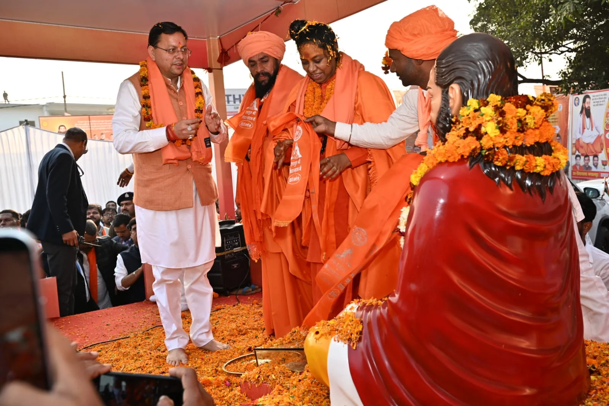
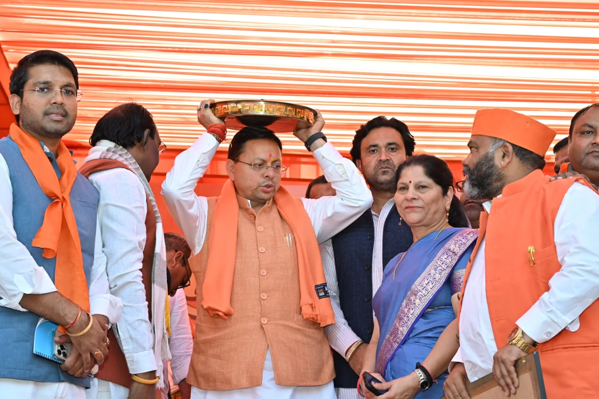
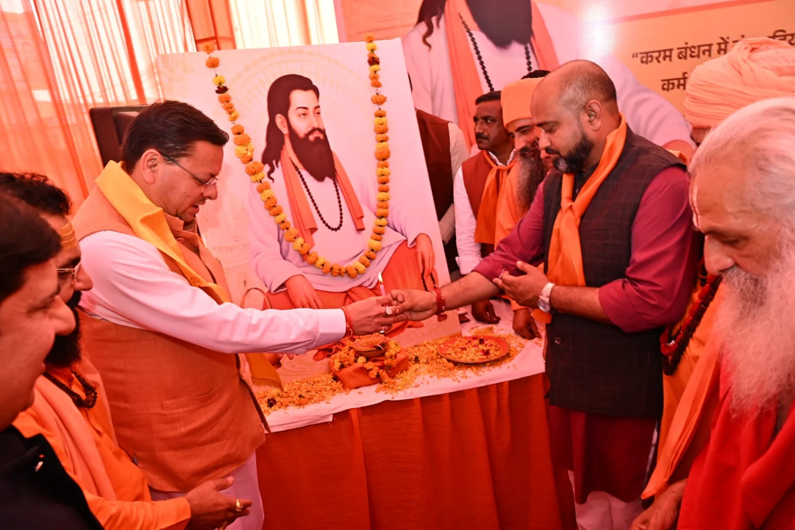
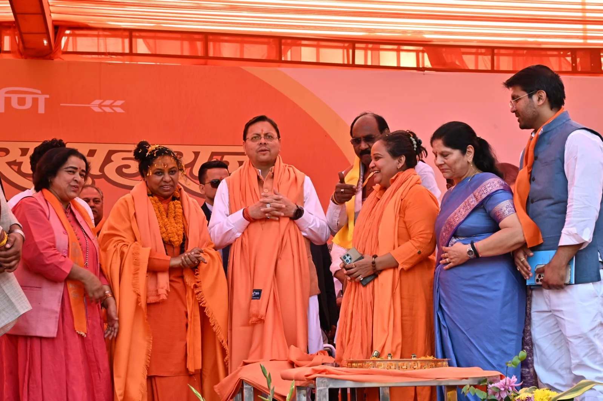
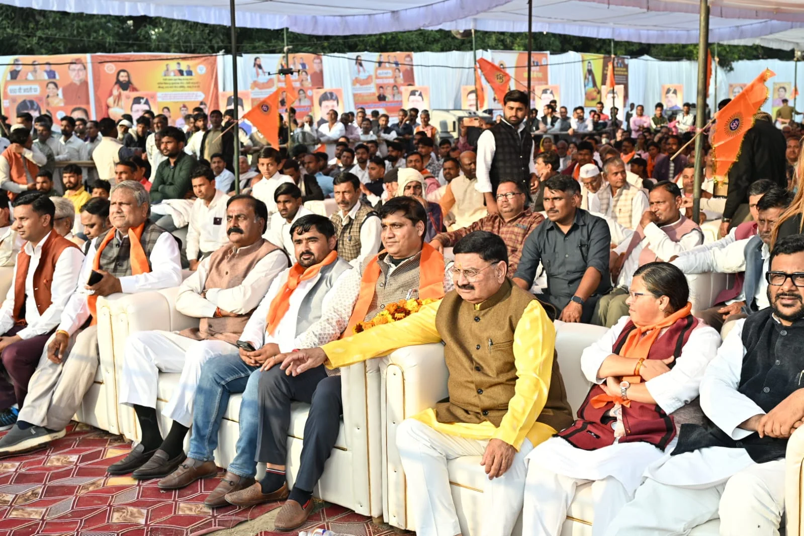
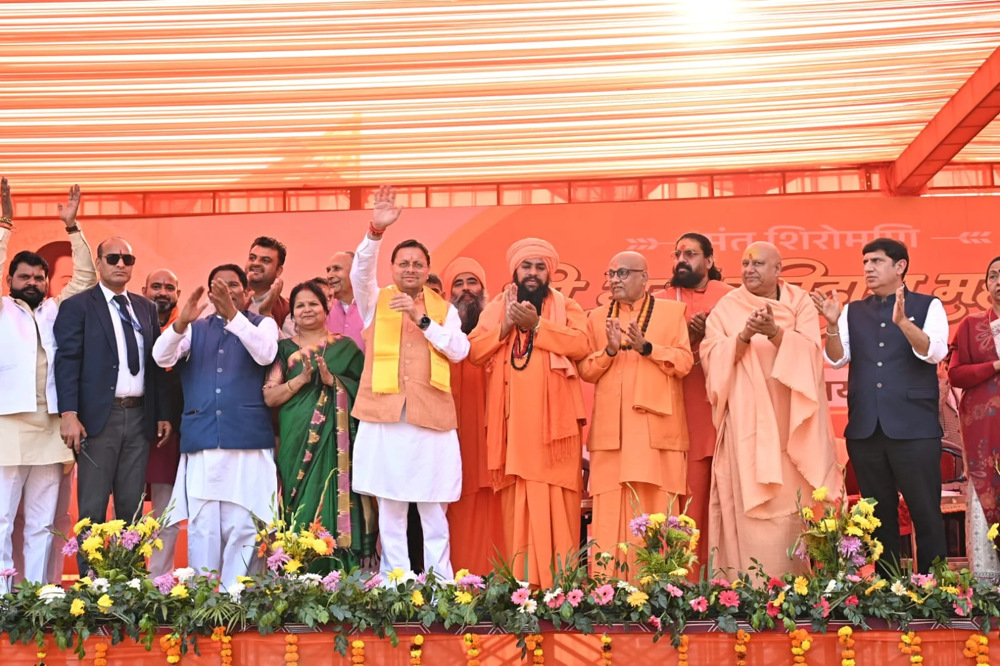

**हरिद्वार संवाददाता | आसिफ खान

धनौरी (हरिद्वार)।** संत शिरोमणि श्री गुरु रविदास महाराज जी की 650वीं जयंती वर्ष के अवसर पर धनौरी में आयोजित समरसता संकल्प यात्रा ने सामाजिक एकता, समानता और भाईचारे का बड़ा संदेश दिया। डॉ. पृथ्वी सिंह विकसित डिग्री कॉलेज में आयोजित इस कार्यक्रम में मुख्यमंत्री पुष्कर सिंह धामी ने दीप प्रज्वलित कर शुभारंभ किया। मुख्यमंत्री ने संत रविदास जी के विचारों को समाज के लिए मार्गदर्शक बताते हुए कहा कि उनकी शिक्षाओं को केवल स्मरण करने से नहीं, बल्कि उन्हें अपने आचरण और शासन व्यवस्था में उतारने से ही वास्तविक सामाजिक समरसता स्थापित होगी।

मुख्यमंत्री ने स्पष्ट शब्दों में कहा कि संत रविदास जी महाराज ने जिस ऐसे समाज की कल्पना की थी, जहां किसी के साथ जाति, वर्ग अथवा भेदभाव के आधार पर अन्याय न हो, उसी विचारधारा को आगे बढ़ाने के लिए प्रदेश सरकार निरंतर प्रयास कर रही है। उन्होंने समान नागरिक संहिता (यूसीसी) को सामाजिक समानता की दिशा में सरकार का महत्वपूर्ण कदम बताते हुए कहा कि उत्तराखंड देश का पहला राज्य बना, जहां इसे लागू किया गया। उनके अनुसार, प्रदेश में सभी नागरिकों के लिए समान कानून की व्यवस्था सामाजिक न्याय की भावना को मजबूत करती है।

**सिर्फ नारों से नहीं, विकास के कामों से स्थापित होगी समानता**

मुख्यमंत्री ने कहा कि सामाजिक समरसता की बातें मंचों और भाषणों तक सीमित नहीं रहनी चाहिए। समाज के अंतिम पायदान पर खड़े व्यक्ति को भी विकास की मुख्यधारा से जोड़ना जरूरी है। इसी उद्देश्य से अनुसूचित जाति बहुल क्षेत्रों और वंचित वर्गों के लिए सड़क, पेयजल, बिजली, शिक्षा और स्वास्थ्य जैसी बुनियादी सुविधाओं को मजबूत किया जा रहा है।

उन्होंने जानकारी दी कि अनुसूचित जाति उपयोजना एवं ट्राइबल सब प्लान के अंतर्गत पिछले छह वित्तीय वर्षों में लगभग 239 करोड़ रुपये जारी किए गए हैं। इन योजनाओं के माध्यम से विभिन्न क्षेत्रों में विकास कार्यों को स्वीकृति देकर बुनियादी सुविधाओं के विस्तार पर जोर दिया जा रहा है।

**एक लाख से अधिक विद्यार्थियों को 114 करोड़ की छात्रवृत्ति**

शिक्षा को सामाजिक बदलाव का सबसे मजबूत माध्यम बताते हुए मुख्यमंत्री ने कहा कि आर्थिक तंगी किसी भी विद्यार्थी के भविष्य के रास्ते में बाधा नहीं बननी चाहिए। इसी सोच के तहत पूर्वदशम एवं दशमोत्तर छात्रवृत्ति योजनाएं संचालित की जा रही हैं। पिछले तीन वित्तीय वर्षों में एक लाख से अधिक विद्यार्थियों को लगभग 114 करोड़ रुपये की छात्रवृत्ति प्रदान की गई है।

उन्होंने प्रधानमंत्री अनुसूचित जाति अभ्युदय योजना का उल्लेख करते हुए कहा कि अनुसूचित जाति बहुल गांवों में बुनियादी सुविधाएं विकसित कर उन्हें आदर्श ग्राम बनाने की दिशा में कार्य किया जा रहा है। वहीं, बाबू जगजीवन राम छात्रावास योजना के तहत देहरादून, अल्मोड़ा और नैनीताल में छात्रावासों का निर्माण कराया जा रहा है।

**अंतरजातीय विवाह को प्रोत्साहन, बेटियों की शादी के लिए भी सहायता**

मुख्यमंत्री ने कहा कि जातिगत भेदभाव समाप्त करने और सामाजिक एकता को मजबूत करने के लिए अंतरजातीय विवाह प्रोत्साहन योजना भी चलाई जा रही है। इसके अंतर्गत पात्र दंपत्तियों को 50 हजार रुपये की आर्थिक सहायता दी जाती है। पिछले तीन वर्षों में 209 दंपत्तियों को एक करोड़ रुपये से अधिक की सहायता उपलब्ध कराई गई है।

इसके साथ ही गरीब एवं जरूरतमंद अनुसूचित जाति परिवारों की बेटियों के विवाह के लिए शादी अनुदान योजना संचालित की जा रही है। पात्र परिवारों की अधिकतम दो बेटियों के विवाह पर प्रत्येक बेटी के लिए 50 हजार रुपये की आर्थिक सहायता सीधे उपलब्ध कराई जा रही है।

**स्वच्छकार भाई-बहनों की सुरक्षा और सम्मान पर जोर**

मुख्यमंत्री ने नमस्ते योजना का उल्लेख करते हुए कहा कि स्वच्छकार भाई-बहनों की सुरक्षा, गरिमा और सम्मानजनक रोजगार सरकार की प्राथमिकताओं में शामिल है। उन्हें असुरक्षित सीवर एवं सेप्टिक टैंक की सफाई से मुक्त करने के साथ स्वरोजगार के अवसर उपलब्ध कराने पर विशेष ध्यान दिया जा रहा है।

उन्होंने कहा कि संत रविदास जी महाराज की शिक्षाएं आज भी समाज को जोड़ने और भेदभाव मिटाने की प्रेरणा देती हैं। सरकार का लक्ष्य सबका साथ, सबका विकास, सबका विश्वास और सबका प्रयास की भावना के साथ प्रत्येक वर्ग को विकास की मुख्यधारा में शामिल करना है।

**समरसता संकल्प यात्रा से सामाजिक एकजुटता का आह्वान**

मुख्यमंत्री ने संत रविदास जी महाराज की 650वीं जयंती वर्ष पर आयोजित समरसता संकल्प यात्रा को सामाजिक एकता, समानता और भाईचारे की भावना को मजबूत करने वाला महत्वपूर्ण आयोजन बताया। उन्होंने उपस्थित लोगों से आह्वान किया कि संत रविदास जी के आदर्शों को अपने जीवन, व्यवहार और सामाजिक गतिविधियों में अपनाएं, ताकि भेदभाव रहित और समरस समाज का निर्माण हो सके।

कार्यक्रम में महानिर्वाणी अखाड़े के श्रीमहंत रवींद्र पुरी महाराज, महामंडलेश्वर स्वामी यतींद्रानंद गिरि महाराज, बाबा हठयोगी महाराज, स्वामी प्रबोधनंद गिरी महाराज, महंत अरुणदास जी महाराज, पूर्व मंत्री स्वामी यतीश्वरानंद, भाजपा प्रदेश अध्यक्ष महेंद्र भट्ट, कैबिनेट मंत्री खजान दास, कैबिनेट मंत्री प्रदीप बत्रा, भाजपा जिलाध्यक्ष डॉ. मधु सिंह, जिला पंचायत अध्यक्ष किरण चौधरी, राज्यसभा सांसद कल्पना सैनी, रुड़की मेयर अनीता अग्रवाल, राज्य मंत्री देशराज कर्णवाल, राज्यमंत्री श्यामवीर सैनी, भाजपा जिला महामंत्री अक्षय प्रताप सिंह, लाल सिंह आर्य, भोला सिंह एवं गजेंद्र यादव सहित अनेक गणमान्य लोग मौजूद रहे।

इसके अलावा आयुक्त गढ़वाल मंडल आनंद स्वरूप, जिलाधिकारी मयूर दीक्षित, वरिष्ठ पुलिस अधीक्षक नवनीत सिंह भुल्लर, मुख्य विकास अधिकारी डॉ. ललित नारायण मिश्र सहित विभिन्न विभागों के अधिकारी, जनप्रतिनिधि और भारी संख्या में स्थानीय नागरिकों ने कार्यक्रम में प्रतिभाग किया।

संदेश साफ है—संत रविदास जी के विचारों को केवल जयंती समारोह तक सीमित न रखकर सामाजिक व्यवहार और विकास की नीतियों में उतारना ही सच्ची श्रद्धांजलि है।
