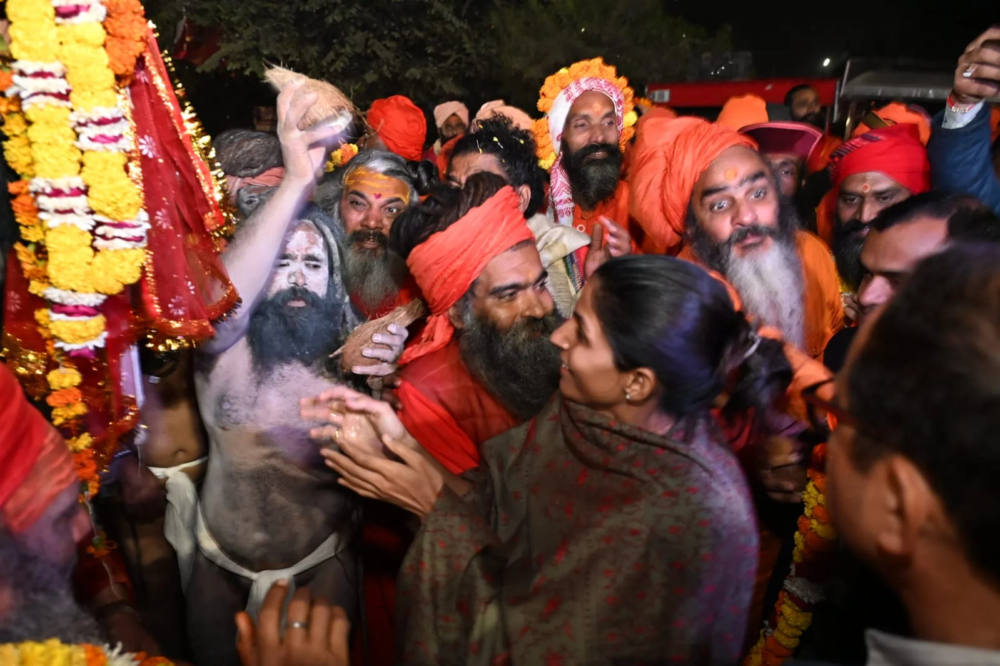
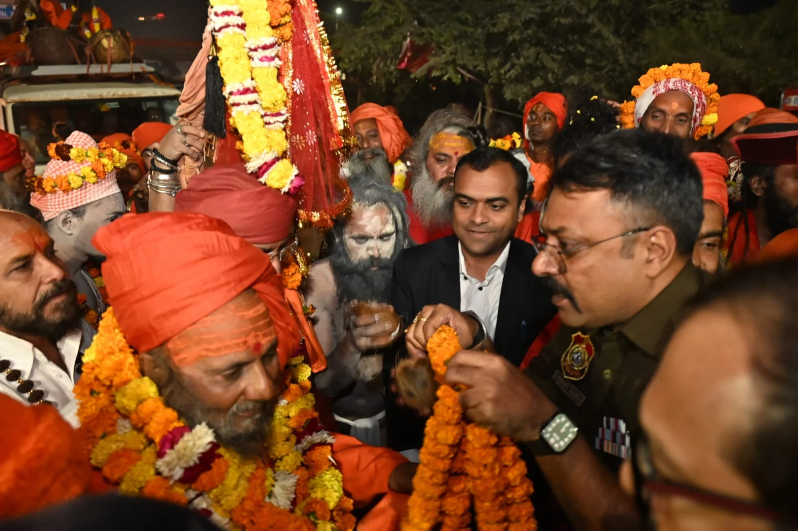
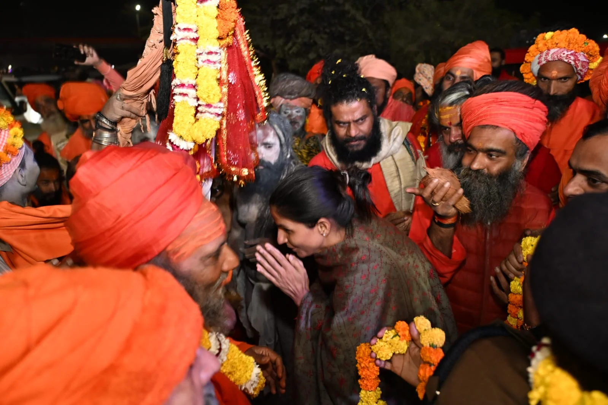
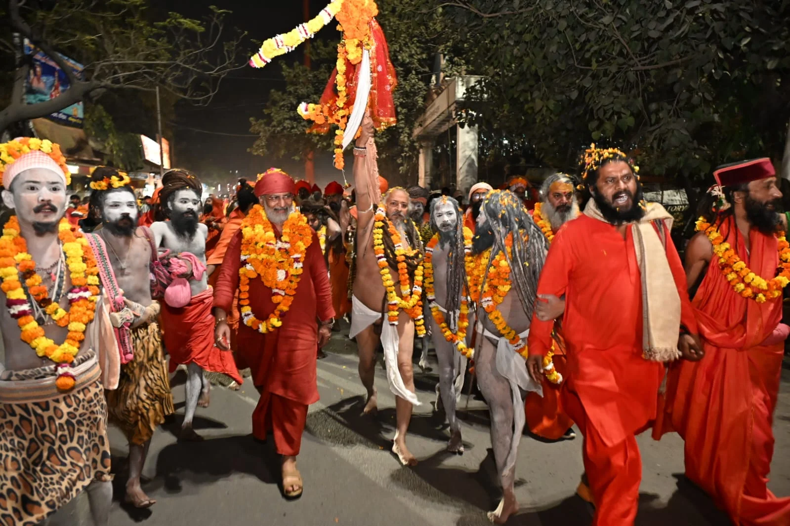

**हरिद्वार संवाददाता | आसिफ खान

हरिद्वार।** धर्मनगरी हरिद्वार में कुंभ-2027 की धार्मिक गतिविधियों का विधिवत आगाज हो गया है। श्री पंचदशनाम जूना अखाड़े के रमता पंचों की जमात के भव्य नगर प्रवेश के साथ ही कुंभ की आध्यात्मिक हलचल तेज हो गई है। मंगलवार की शाम जैसे ही जूना अखाड़े के रमता पंच कुंभ नगरी हरिद्वार पहुंचे, पूरा वातावरण हर-हर महादेव के जयघोष से गुंजायमान हो उठा। चंडी चौक पर पुष्पवर्षा, बैंड-बाजे और पारंपरिक धार्मिक उत्साह के बीच संतों का भव्य स्वागत किया गया। इस ऐतिहासिक धार्मिक अवसर ने साफ संकेत दे दिया कि हरिद्वार में कुंभ-2027 की तैयारियां अब केवल प्रशासनिक बैठकों तक सीमित नहीं, बल्कि धरातल पर धार्मिक परंपराओं के साथ आगे बढ़ने लगी हैं।

चंडी चौक पर आयोजित स्वागत समारोह में मेला प्रशासन, जिला प्रशासन और पुलिस विभाग के वरिष्ठ अधिकारियों ने जूना अखाड़े की अगुवाई कर रहे संत-महात्माओं और रमता पंचों का माल्यार्पण कर स्वागत किया। इस दौरान मेलाधिकारी सोनिका, आईजी कुंभ डॉ. योगेंद्र सिंह रावत, जिलाधिकारी मयूर दीक्षित, एसएसपी हरिद्वार नवनीत सिंह भुल्लर, एसएसपी कुंभ आयुष अग्रवाल, अपर मेलाधिकारी नंदन कुमार, अपर मेलाधिकारी दयानंद सरस्वती और उप मेलाधिकारी मंजीत सिंह सहित अनेक अधिकारी मौजूद रहे।

इस अवसर पर जूना अखाड़े के अंतरराष्ट्रीय अध्यक्ष महंत प्रेम गिरि जी, उपाचार्य ब्रह्मनिष्ठ सुश्री कपिलपुरी जी महाराज, प्रवक्ता श्रीमहंत नारायण गिरि जी महाराज, वरिष्ठ अध्यक्ष उमाशंकर भारती जी, उपाध्यक्ष विद्यानंद सरस्वती जी और महामंत्री केदार पुरी जी सहित बड़ी संख्या में वरिष्ठ संत एवं नागा साधु उपस्थित रहे।

**रमता पंचों के प्रवेश से शुरू हुआ अखाड़ों की धार्मिक गतिविधियों का दौर**

कुंभ मेले में रमता पंचों का नगर प्रवेश केवल एक धार्मिक यात्रा नहीं, बल्कि अखाड़ों की पारंपरिक व्यवस्थाओं और आध्यात्मिक गतिविधियों की शुरुआत का महत्वपूर्ण संकेत माना जाता है। रमता पंच अखाड़े के वरिष्ठ संतों और प्रतिनिधियों का वह समूह होता है, जो प्रमुख धार्मिक अवसरों पर अखाड़े की परंपराओं के अनुसार विभिन्न स्थानों की यात्रा करता है।

कुंभ में छावनी स्थापना, भूमिपूजन, धर्मध्वजा स्थापना और पेशवाई जैसी महत्वपूर्ण धार्मिक परंपराओं के संचालन में रमता पंचों की अहम भूमिका रहती है। उनके आगमन के साथ ही कुंभ क्षेत्र में अखाड़ों की गतिविधियां तेज होने लगी हैं। आने वाले दिनों में अन्य अखाड़ों की मौजूदगी भी बढ़ेगी और धर्मनगरी में साधु-संतों की छावनियां बसने का सिलसिला शुरू होगा।

**दिसंबर में भूमिपूजन, जनवरी में निकलेगी भव्य पेशवाई**

जूना अखाड़े के निर्धारित कार्यक्रम के अनुसार कुंभ मेला क्षेत्र में छावनी स्थापना के लिए 1 दिसंबर 2026 को भूमिपूजन किया जाएगा। इसके बाद 23 दिसंबर 2026 को धर्मध्वजा स्थापना का कार्यक्रम आयोजित होगा। वहीं 14 जनवरी 2027 को जूना अखाड़े की भव्य पेशवाई निकाली जाएगी। इन धार्मिक आयोजनों के साथ कुंभ की परंपरागत छटा और अधिक भव्य रूप में दिखाई देने लगेगी।

**अखाड़ों की परंपराओं और संतों की सुविधाओं को लेकर प्रशासन प्रतिबद्ध: सोनिका**

मेलाधिकारी सोनिका ने कहा कि कुंभ-2027 की तैयारियां अखाड़ों, साधु-संतों और संबंधित विभागों के समन्वय से की जा रही हैं। अखाड़ों की धार्मिक परंपराएं कुंभ की विशिष्ट पहचान हैं और मेला प्रशासन इनका पूरा सम्मान करते हुए आवश्यक सुविधाएं, सुरक्षा एवं अन्य व्यवस्थाएं उपलब्ध कराने के लिए प्रतिबद्ध है।

उन्होंने कहा कि मुख्यमंत्री पुष्कर सिंह धामी के निर्देशों के अनुरूप कुंभ से संबंधित सभी तैयारियां समयबद्ध तरीके से पूरी की जा रही हैं, ताकि देश-विदेश से आने वाले श्रद्धालुओं को सुरक्षित, सुगम और सुव्यवस्थित व्यवस्थाएं मिल सकें। हरिद्वार कुंभ को उसकी आध्यात्मिक और सांस्कृतिक गरिमा के अनुरूप दिव्य एवं भव्य स्वरूप प्रदान करना प्रशासन की प्राथमिकता है।

**कुंभ-2027 की प्रमुख स्नान तिथियां
तिथि	पर्व एवं स्नान**

14 जनवरी 2027	मकर संक्रांति
06 फरवरी 2027	मौनी अमावस्या
11 फरवरी 2027	बसंत पंचमी
20 फरवरी 2027	माघ पूर्णिमा
06 मार्च 2027	महाशिवरात्रि (अमृत स्नान)
08 मार्च 2027	फाल्गुन अमावस्या (अमृत स्नान)
15 मार्च 2027	देव डोलियों का अमृत स्नान
07 अप्रैल 2027	नव संवत्सर
14 अप्रैल 2027	मेष संक्रांति (अमृत स्नान)
15 अप्रैल 2027	श्रीराम नवमी
20 अप्रैल 2027	चैत्र पूर्णिमा

कुल मिलाकर जूना अखाड़े के रमता पंचों का हरिद्वार आगमन कुंभ-2027 की धार्मिक तैयारियों में एक महत्वपूर्ण पड़ाव है। अब धर्मनगरी में अखाड़ों की छावनियां, धर्मध्वजाएं, पेशवाई और संतों की परंपरागत गतिविधियां कुंभ के उत्साह को नई ऊंचाई देंगी। हर-हर महादेव के जयघोष के साथ हरिद्वार में कुंभ का रंग चढ़ना शुरू हो चुका है।
