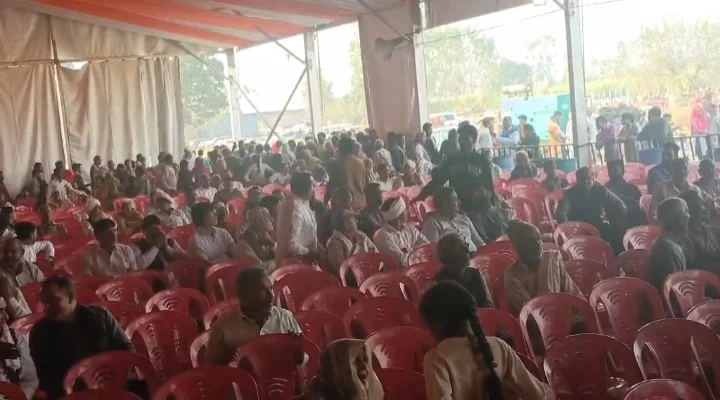
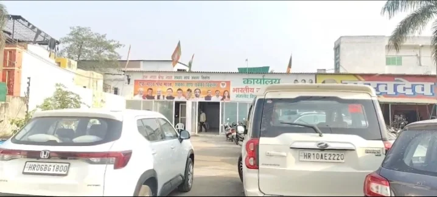
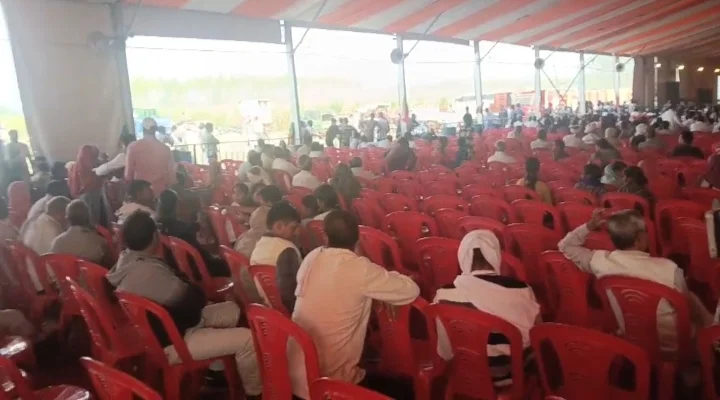

**हरिद्वार/रूडकी विशेष संवाददाता | आसिफ खान** 

**नारसन/मंगलौर।** मंगलौर विधानसभा की राजनीति में अपनी ताकत दिखाने के इरादे से आयोजित जन आशीर्वाद रैली अब करतार सिंह बढ़ाना के लिए राजनीतिक सवालों का कारण बनती दिखाई दे रही है। मुख्यमंत्री पुष्कर सिंह धामी की मौजूदगी में आयोजित इस कार्यक्रम को बड़े शक्ति प्रदर्शन के रूप में पेश करने की कोशिश की गई, लेकिन रैली के दौरान जो नजारा सामने आया, उसने इस आयोजन की सफलता के दावों पर ही सवालिया निशान लगा दिए। मंच पर मुख्यमंत्री सरकार की उपलब्धियां गिनाते रहे और दूसरी तरफ पंडाल में बैठे लोग एक-एक करके उठकर जाने लगे। देखते ही देखते सैकड़ों लोगों ने मुख्यमंत्री का संबोधन पूरा होने से पहले ही कार्यक्रम स्थल छोड़ दिया।

जिस रैली में भारी भीड़ दिखाकर राजनीतिक ताकत का संदेश देने की तैयारी थी, उसी रैली में मुख्यमंत्री के भाषण के दौरान पंडाल खाली होने लगा। आखिर जनता को सरकार की उपलब्धियां सुनने में दिलचस्पी क्यों नहीं रही? क्या लोगों को केवल मुख्यमंत्री के आगमन तक ही कार्यक्रम में रुकना था? क्या यह आयोजन जनसमर्थन जुटाने के बजाय केवल भीड़ का आंकड़ा दिखाने तक सीमित रह गया? इन सवालों ने करतार सिंह बढ़ाना के शक्ति प्रदर्शन की चमक फीकी कर दी है।

**हरियाणा-UP की गाड़ियों का काफिला, मंगलौर में आखिर किसका शक्ति प्रदर्शन?**

रैली में हरियाणा और उत्तर प्रदेश की नंबर प्लेट वाली गाड़ियों का बड़ा काफिला भी चर्चा का विषय बना रहा। कार्यक्रम में दूसरे राज्यों से आए लोगों की मौजूदगी को लेकर सवाल उठ रहे हैं। आरोप है कि रैली में भीड़ बढ़ाने के लिए हरियाणा और उत्तर प्रदेश के लोगों का सहारा लिया गया। यदि इन आरोपों में सच्चाई है तो यह स्थानीय राजनीतिक जनाधार के लिहाज से बेहद गंभीर सवाल है।

मंगलौर विधानसभा क्षेत्र में अपनी राजनीतिक जमीन मजबूत करने का दावा करने वाले करतार सिंह बढ़ाना को आखिर दूसरे राज्यों से लोगों की मौजूदगी के सहारे शक्ति प्रदर्शन करने की जरूरत क्यों पड़ रही है? क्या स्थानीय कार्यकर्ताओं में उत्साह की कमी है? क्या क्षेत्र की जनता से अपेक्षित समर्थन नहीं मिल रहा? या फिर चुनावी माहौल बनाने के लिए बाहरी भीड़ का सहारा लेना जरूरी हो गया है?

**पंडाल भरने की कोशिश, लेकिन जनता को रोकने में नाकाम रहे आयोजक!**

किसी भी राजनीतिक रैली की सफलता केवल इस बात से नहीं मापी जाती कि पंडाल में कितनी कुर्सियां भरी थीं। असली परीक्षा तब होती है जब नेता जनता के सामने अपनी बात रखता है और लोग उसे सुनने के लिए रुकते हैं। नारसन की रैली में मुख्यमंत्री के भाषण के दौरान लोगों का उठकर जाना आयोजकों के लिए असहज करने वाला दृश्य रहा।

सरकार की उपलब्धियों का बखान हो रहा था, लेकिन पंडाल में लोगों की मौजूदगी लगातार कम होती दिखाई दी। सवाल यह भी है कि यदि रैली में मौजूद लोगों को मुख्यमंत्री का संबोधन ही पूरा सुनना मंजूर नहीं था तो फिर इस आयोजन को किस आधार पर सफल बताया जाएगा? क्या आयोजकों के लिए भीड़ की संख्या ही सबसे बड़ा लक्ष्य था या जनता की भागीदारी भी कोई मायने रखती है?

**करतार सिंह बढ़ाना की चुनावी रणनीति पर सवाल—भीड़ के भरोसे कितनी दूर जाएंगे?**

मंगलौर विधानसभा क्षेत्र में चुनावी राजनीति का रास्ता स्थानीय जनता के बीच से होकर गुजरता है। यहां के मतदाता किसी बाहरी राजनीतिक प्रदर्शन से नहीं, बल्कि अपने क्षेत्र के मुद्दों और नेताओं के काम से फैसला करते हैं। ऐसे में करतार सिंह बढ़ाना के सामने सबसे बड़ी चुनौती यह है कि वह अपनी स्थानीय स्वीकार्यता कितनी साबित कर पाते हैं।

हरियाणा और उत्तर प्रदेश से आने वाली गाड़ियां रैली स्थल की तस्वीर जरूर बदल सकती हैं, लेकिन क्या वे मंगलौर के चुनावी समीकरण बदल सकती हैं? क्या दूसरे राज्यों से आए लोग यहां के मतदाताओं की जगह ले पाएंगे? क्या बाहरी भीड़ के सहारे स्थानीय जनता का भरोसा हासिल किया जा सकता है?

**इन सवालों का जवाब रैली की तस्वीरों से नहीं, बल्कि क्षेत्र में करतार सिंह बढ़ाना की वास्तविक राजनीतिक पकड़ से मिलेगा।**

**मुख्यमंत्री की मौजूदगी में भी नहीं दिखा लोगों का ठहराव, फिर किस बात का शक्ति प्रदर्शन?**

मुख्यमंत्री पुष्कर सिंह धामी की मौजूदगी किसी भी राजनीतिक आयोजन के लिए बड़ा आकर्षण मानी जाती है। लेकिन नारसन की रैली में उनके संबोधन के दौरान ही लोगों का उठकर जाना चर्चा का विषय बन गया। यह दृश्य आयोजकों की तैयारियों और भीड़ के दावों पर सवाल खड़े करता है। जिस कार्यक्रम को जनसमर्थन का बड़ा उदाहरण बताया जा रहा था, वहां भाषण के बीच लोगों का जाना आखिर किस बात का संकेत है?

करतार सिंह बढ़ाना को अब केवल मंच और पंडाल की तस्वीरों से आगे बढ़कर यह बताना होगा कि मंगलौर की जनता के बीच उनका वास्तविक समर्थन कितना है। आखिर स्थानीय जनता की भागीदारी कितनी थी? दूसरे राज्यों से आई गाड़ियों का उद्देश्य क्या था? और मुख्यमंत्री के भाषण के दौरान पंडाल से लोग क्यों निकलने लगे?

**मंगलौर की जनता के सामने असली परीक्षा, बाहरी भीड़ से नहीं बनेगा चुनावी जनाधार!**

नारसन की जन आशीर्वाद रैली ने करतार सिंह बढ़ाना के सामने कई राजनीतिक सवाल खड़े कर दिए हैं। एक तरफ हरियाणा और उत्तर प्रदेश की गाड़ियों की मौजूदगी पर चर्चा है, दूसरी तरफ मुख्यमंत्री के भाषण के दौरान पंडाल छोड़ते लोगों का दृश्य है। ऐसे में इस रैली को निर्विवाद रूप से सफल शक्ति प्रदर्शन बताना आसान नहीं होगा।

मंगलौर की जनता को यह देखना है कि कौन नेता उनके बीच मौजूद रहता है, कौन उनकी समस्याओं को उठाता है और कौन वास्तव में क्षेत्र के विकास के लिए काम करता है। राजनीतिक रैलियों में भीड़ जुटाने से ज्यादा जरूरी जनता के बीच विश्वास कायम करना है।

क्योंकि पंडाल में कुर्सियां भरने के लिए लोगों को बुलाया जा सकता है, लेकिन चुनाव की ईवीएम में वोट डालने के लिए मंगलौर की जनता ही जाएगी। हरियाणा और उत्तर प्रदेश के गाड़ियों के काफिले से तस्वीरें तो बन सकती हैं, लेकिन जीत की गारंटी नहीं! अब सवाल यही है—करतार सिंह बढ़ाना का असली जनाधार मंगलौर में कितना है?
